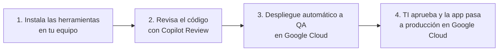

# Cada área puede crear sus propias apps con IA

Quien conoce la necesidad crea la solución con IA y la prueba con su equipo. Así el negocio puede avanzar desde el primer día dentro del flujo de TI.

1. **Instala las herramientas.** Preparas tu equipo una sola vez y usas la IA para crear la app que tu área necesita.
2. **Revisa con Copilot Review.** Un agente revisa la calidad del código y señala posibles desvíos de los lineamientos de TI.
3. **Prueba en QA.** Al integrar los cambios, la app se despliega automáticamente a un entorno de pruebas en Google Cloud para que tu equipo la valide.
4. **Pase a producción.** Después de la validación, TI da el visto bueno y el despliegue a producción en Google Cloud se ejecuta automáticamente.

## ¿Qué gana el negocio?

- **Más rapidez y menos esperas.** Cada área puede crear y ajustar su app directamente. Los despliegues automáticos reducen los pasos manuales.
- **Un estándar de TI.** Las apps siguen el mismo flujo de trabajo y usan la arquitectura, el diseño y las tecnologías definidos por TI.
- **Recursos de la empresa.** La revisión, las pruebas y la publicación se hacen dentro del entorno corporativo, con herramientas e infraestructura propias.
