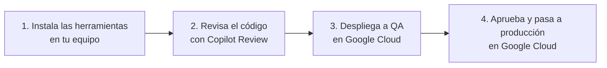

# De la idea a producción con IA

1. **Prepara tu equipo.** Instalas las herramientas una sola vez y ya puedes trabajar con IA.
2. **Revisa con Copilot Review.** La IA señala posibles problemas antes de integrar los cambios.
3. **Prueba en QA.** Al integrar los cambios, se publica una versión de prueba en Google Cloud para que el equipo la valide.
4. **Da el visto bueno.** Después de la validación, TI aprueba la salida a producción en Google Cloud.

## ¿Qué gana el negocio?

Menos tiempo entre una idea y su primera prueba. Copilot ayuda a detectar problemas temprano, el equipo puede probar y pedir ajustes, y TI decide cuándo se publica.
