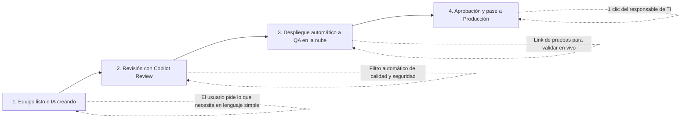

# Creación Rápida de Aplicaciones con IA (Flujo de 4 Pasos)

Así transformamos una idea del negocio en una aplicación real, segura y lista para usar, sin cuellos de botella ni riesgos para la empresa.

### ¿Qué pasa en cada paso?
1. **Instalación de herramientas en el equipo:** Se deja la PC lista una sola vez con las herramientas base y reglas de la empresa. Desde ahí, cualquier persona del área le pide a la IA lo que necesita en sus propias palabras y lo prueba en su máquina al instante.
2. **Revisión de código con Copilot Review:** Antes de subir nada, un revisor automático con IA (junto con pruebas de seguridad) verifica que todo cumpla las normas de la empresa y no tenga fallos ni datos expuestos.
3. **Despliegue a QA (Nube GCP):** Apenas pasa la revisión, el sistema publica automáticamente una versión de pruebas en la nube y entrega un enlace web para que el usuario y su equipo la validen en vivo.
4. **Aprobación y pase a Producción (Nube GCP):** Cuando el usuario confirma que todo funciona como esperaba, TI revisa y aprueba con un solo clic la salida oficial a Producción.

---

### Ventajas para el negocio
- **De semanas a días (o horas):** Las áreas resuelven sus propias necesidades operativas sin esperar meses en la cola de TI.
- **Cero caos ni apps "pirata":** Todo nace ordenado bajo un mismo estándar visual, misma base de datos segura y dentro de la cuenta de la empresa.
- **Seguridad garantizada sin frenar:** Ninguna contraseña viaja en las PCs ni en el código, y nada llega a Producción sin pasar primero por filtros automáticos y el visto bueno de TI.
- **Control total de costos:** Se usa una infraestructura unificada en la nube donde solo pagamos por lo que realmente se utiliza.
